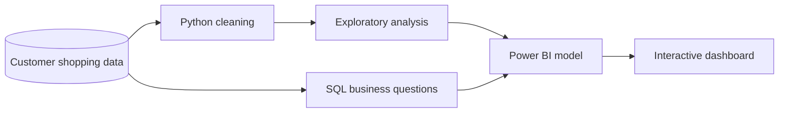

# Customer Shopping Behavior Analysis

 
 

 

**An end-to-end customer shopping behavior analysis project**

 

## Overview

This project explores customer purchase patterns from **3,900 shopping records**. It combines data cleaning and exploratory analysis in Python, business-focused SQL queries, and an interactive Power BI dashboard to answer practical retail questions.

The analysis focuses on:

- Customer demographics and age groups
- Revenue by gender and customer segment
- Product ratings and purchasing trends
- Subscription behavior and repeat purchases
- Discount usage and promotional activity
- Shipping preferences and purchase frequency

## Dashboard

The Power BI report is included in [`Customer_Shooping Analysis.pbix`](./Customer_Shooping%20Analysis.pbix).

> **Live dashboard:** Open the deployed report with the **View Live Dashboard** button above. Access may require permission in the Power BI workspace.

### Dashboard preview

To add a real preview, export a dashboard page as an image and replace the image URL above with its repository path, for example `./assets/dashboard-preview.png`.

## Project workflow

## Key business questions

The SQL analysis in [`project.sql`](./project.sql) investigates:

1. How does revenue compare between male and female customers?
2. Which discounted customers still spend above average?
3. Which products have the highest average review ratings?
4. How do standard and express shipping customers compare?
5. Do subscribers spend more than non-subscribers?
6. Which products have the highest discount-purchase rate?
7. How many customers are new, returning, or loyal?
8. What are the three most purchased products in each category?
9. Are repeat buyers more likely to subscribe?
10. Which age groups contribute the most revenue?

## Repository contents

| File | Description |
| --- | --- |
| [`customer_shopping_behavior.csv`](./customer_shopping_behavior.csv) | Source customer shopping dataset |
| [`shopping.ipynb`](./shopping.ipynb) | Python cleaning and exploratory analysis |
| [`project.sql`](./project.sql) | SQL business analysis queries |
| [`Customer_Shooping Analysis.pbix`](./Customer_Shooping%20Analysis.pbix) | Power BI report |
| [`Customer Shopping Behavior Analysis.pdf`](./Customer%20Shopping%20Behavior%20Analysis.pdf) | Exported analysis/report document |
| [`read.txt`](./read.txt) | Analysis notes and transformation explanations |

## Methods and tools

| Area | Tools |
| --- | --- |
| Data preparation | Python, pandas, missing-value imputation |
| Customer segmentation | Quantile-based age groups and purchase-history segments |
| Business analysis | SQL aggregations, CTEs, window functions |
| Reporting | Microsoft Power BI |

## Getting started

### Python notebook

1. Clone this repository.
2. Open [`shopping.ipynb`](./shopping.ipynb) in Jupyter Notebook or VS Code.
3. Update the dataset path in the notebook if your local folder differs.
4. Run the cells to reproduce the cleaning and exploratory analysis.

### Power BI report

Open [`Customer_Shooping Analysis.pbix`](./Customer_Shooping%20Analysis.pbix) in Power BI Desktop. If you publish an updated report, update the live URL in this README.

## Author

**Saikat Dash**

If this analysis is useful, consider leaving a ⭐ on the repository.
